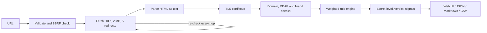

# PhishLens TN


**Paste a suspicious link and see what it is really doing, without opening it.**

PhishLens TN is a phishing page analyzer tuned for Tunisian brands: banks (BIAT, STB, BNA, Attijari Bank, Amen Bank, ATB, UIB, Banque Zitouna), La Poste Tunisienne, telecom operators (Tunisie Telecom, Ooredoo Tunisie, Orange Tunisie) and payment services (D17, Clictopay, Paymee). It downloads the page as plain text, never executes its JavaScript, never submits a form, and explains every finding in plain English with a weighted, extensible rule engine.

## Features

- **Safe fetching.** 10 s timeout, 2 MB cap, at most 5 redirects (full chain recorded), custom User-Agent. SSRF protection blocks localhost, private, link-local, carrier-grade NAT and multicast addresses, non-http(s) schemes, and re-checks **every redirect target**. A connection guard re-validates the IP at connect time to defeat DNS rebinding.
- **Static page analysis.** Forms (action, method, input types, password and hidden fields, sensitive-field detection for passwords, card data, OTP, PIN and identity numbers), external domains (links, scripts, images, styles, form targets), title, favicon domain, iframes (including hidden ones), meta refresh, obfuscated-script patterns, right-click blocking and bot-based data collection (Telegram bots, Discord webhooks and similar).
- **TLS inspection.** Issuer, validity dates, certificate age in days, SAN list, host-name match and chain trust, decoded with a small built-in X.509 reader (no extra dependencies).
- **Domain checks.** Registered domain (Public Suffix List snapshot, offline), subdomain depth, suspicious TLDs, punycode and homoglyphs, free-hosting platforms and domain age through RDAP (fails gracefully when unavailable).
- **Brand detection.** `data/brands.json` lists the brands and their official domains. PhishLens flags brand names in the title, text, URL path and domain that do not match an official domain, official domains used as decoys (`biat.com.tn.evil.example`), assets hot-linked from official sites, and typosquatting (Levenshtein distance, adjacent transpositions, repeated letters, look-alike characters such as `rn`/`m` and `1`/`l`, TLD swaps).
- **Explainable scoring.** 46 documented rules in [`analyzer/rules.py`](analyzer/rules.py), score 0-100, levels Low / Medium / High / Critical, each signal with a name, weight and explanation.
- **Web UI.** Dark cyber theme with a light/dark toggle, real step-by-step progress, animated risk gauge, signal cards, tabs for Forms / Domains / Certificate / Redirects, JSON and Markdown export, accessible and responsive.
- **Batch CLI.** Reads a file of URLs and writes JSON, CSV and a Markdown summary (top targeted brands, most common tricks, average score).
- **Privacy by design.** Credentials are never stored, forms are never submitted, form actions are never followed, results stay in your browser unless you export them.

## How it works



The same pipeline (`analyzer/pipeline.py`) feeds the web UI (as a streamed sequence of progress events), the JSON API and the CLI.

## Install and run

Requirements: Python 3.11 or newer.

```bash
git clone <your-repository-url> phishlens-tn
cd phishlens-tn
python -m venv .venv
source .venv/bin/activate          # Windows: .venv\Scripts\activate
pip install -r requirements-dev.txt
pytest                              # runs fully offline
```

### Web app

```bash
python app.py
# open http://127.0.0.1:5000
```

Production (behind a reverse proxy that terminates TLS):

```bash
pip install gunicorn
gunicorn -w 2 --threads 4 -b 127.0.0.1:8000 "app:create_app()"
```

| Variable | Default | Purpose |
| --- | --- | --- |
| `HOST`, `PORT` | `127.0.0.1`, `5000` | Development server address |
| `PHISHLENS_ANALYZE_LIMIT` | `10/60` | Analyses allowed per client per window (`count/seconds`) |
| `PHISHLENS_EXPORT_LIMIT` | `30/60` | Export requests allowed per client per window |
| `PHISHLENS_MAX_CONCURRENT` | `4` | Analyses running at the same time (others get HTTP 503) |
| `PHISHLENS_RDAP` | `1` | Set to `0` to skip domain-age lookups |
| `PHISHLENS_TRUSTED_PROXIES` | `0` | Number of reverse proxies to trust for `X-Forwarded-For` |
| `PHISHLENS_BRANDS_FILE` | `data/brands.json` | Alternative brand list |

API: `POST /api/analyze` with `{"url": "https://example.com"}` returns the full JSON result. `POST /api/analyze/stream` returns newline-delimited progress events. `POST /api/export/json|markdown` renders a result you send back. `GET /api/rules` lists the rules.

### Command line

```bash
python cli.py analyze https://example.com
python cli.py analyze https://example.com --json
python cli.py analyze https://example.com --markdown --no-rdap

python cli.py batch urls.txt --out-dir results --workers 4
# writes results/results.json, results/results.csv and results/summary.md

python cli.py rules                 # list every rule and weight
```

`urls.txt` holds one URL per line; blank lines and lines starting with `#` are ignored. The sample file only contains safe `example.com` style domains.

## Example output

CLI (`python cli.py analyze ...` on the bundled phishing test page):

```text
PhishLens TN: https://biatt-login.example.com/connexion
Score: 100/100 (Critical)
Verdict: Critical risk: this is very likely a phishing page that appears to impersonate BIAT. Main reasons: Look-alike of an official brand domain; Data is sent to a chat bot or form-collection service. Do not enter credentials, card numbers or codes.

   +38  Look-alike of an official brand domain
        The name 'biatt' in biatt-login.example.com adds a repeated letter to biat.com.tn. It is not an official BIAT domain.
   +30  Data is sent to a chat bot or form-collection service
        The page references Telegram bot API. Phishing kits use these to deliver stolen entries to the attacker.
   +28  Form sends data to another domain
        A form collecting password, card, otp, username posts to example.org, not to example.com. Whatever is typed would be sent to a third party.
   +25  Payment card details requested
        The page asks for payment card details (number, expiry or CVV). Banks never request these through a link you received.
   +18  Images or styles copied live from the official site
        1 images reference(s) point to the official domain biat.com.tn. Phishing kits often reuse the real site's logo to look authentic.
  ... 14 more signals
```

JSON (excerpt):

```json
{
  "url": "https://biatt-login.example.com/connexion",
  "score": 100,
  "level": "Critical",
  "verdict": "Critical risk: this is very likely a phishing page that appears to impersonate BIAT. Main reasons: Look-alike of an official brand domain; Data is sent to a chat bot or form-collection service. Do not enter credentials, card numbers or codes.",
  "signals": [
    {
      "id": "typosquatting",
      "title": "Look-alike of an official brand domain",
      "weight": 38,
      "severity": "critical",
      "explanation": "The name 'biatt' in biatt-login.example.com adds a repeated letter to biat.com.tn. It is not an official BIAT domain."
    },
    {
      "id": "exfil_service",
      "title": "Data is sent to a chat bot or form-collection service",
      "weight": 30,
      "severity": "critical",
      "explanation": "The page references Telegram bot API. Phishing kits use these to deliver stolen entries to the attacker."
    }
  ],
  "brands": {
    "targeted_brands": [
      "BIAT"
    ]
  },
  "page": {
    "title": "BIAT - Espace client | Connexion",
    "forms": [
      {
        "method": "post",
        "resolved_action": "https://collect.example.org/post.php",
        "sensitive_fields": [
          "password",
          "card",
          "otp",
          "username"
        ]
      }
    ]
  }
}
```

The batch summary (`summary.md`) contains the number of analyzed URLs, the average score, a risk-level table, the top targeted brands, the most common tricks with their share, the highest-risk URLs (defanged) and any failures. URLs in Markdown reports are defanged (`hxxps://evil[.]example`) so they are safe to paste into tickets and chats.

## Scoring explained

Each rule that fires adds its weight (mitigations subtract). The sum is clamped to 0-100:

| Level | Score |
| --- | --- |
| Low | 0-24 |
| Medium | 25-49 |
| High | 50-74 |
| Critical | 75-100 |

Weights express how strongly a signal separates phishing from ordinary sites. A password field alone is only +8 because countless legitimate sites have one; a form that sends a password to another domain is +28; a look-alike of an official bank domain is +38. Mitigations such as "served from an official brand domain" (-35) keep real bank pages low. The score is a triage aid, not a verdict.

All built-in rules (generated from the code with `python cli.py rules`):

| Weight | Rule | Category | What it detects |
| ---: | --- | --- | --- |
| +40 | `official_domain_embedded` | brand | The host contains an official brand domain, such as biat.com.tn.evil.com. |
| +38 | `typosquatting` | brand | The domain is a near miss of an official brand domain (typo, swapped or look-alike characters). |
| +30 | `brand_in_domain` | brand | A brand keyword appears in the subdomain or registered domain, but the domain is not official. |
| +30 | `exfil_service` | form | The page code references Telegram bots, Discord webhooks or similar collection endpoints. |
| +30 | `homoglyph_host` | domain | The host mixes scripts or uses characters that imitate Latin letters. |
| +28 | `form_posts_external` | form | A form submits to a different registered domain (+28 if it collects credentials, +6 otherwise). |
| +25 | `card_data_requested` | form | A form asks for card number, expiry or CVV. |
| +25 | `credentials_over_http` | tls | A password or sensitive form lives on, or posts to, an unencrypted URL. |
| +25 | `new_domain` | domain | The registration date (RDAP) is under 30 days (+25), 90 days (+15) or 180 days (+6). |
| +25 | `userinfo_in_url` | url | The URL contains a username section before an @ sign, a classic disguise. |
| +20 | `cert_hostname_mismatch` | tls | The certificate does not list the visited host name. |
| +20 | `form_mailto_action` | form | A form uses a mailto: action, sending its contents to an e-mail address. |
| +20 | `ip_address_host` | url | The link points to a bare (or obfuscated) IP address instead of a domain name. |
| +18 | `brand_assets_hotlinked` | brand | Logos, scripts or the favicon are loaded straight from an official brand domain. |
| +18 | `brand_in_title` | brand | The page title names a Tunisian brand while the site is not on its official domain. |
| +15 | `brand_credential_combo` | brand | Impersonation signals and a page that collects sensitive data appear together. |
| +15 | `cert_not_trusted` | tls | The certificate chain failed verification (self-signed, expired or unknown issuer). |
| +15 | `identity_data_requested` | form | A form asks for CIN, passport, RIB/IBAN or date of birth. |
| +15 | `otp_pin_requested` | form | A form asks for an SMS/OTP code or a PIN. |
| +15 | `password_form_get` | form | A form with a password field uses GET, exposing it in the URL. |
| +12 | `cross_domain_redirects` | redirect | The redirect chain moves between different registered domains (+18 for two or more hops). |
| +12 | `free_hosting` | domain | The page lives on a free hosting, site-builder or tunnelling service. |
| +12 | `meta_refresh_external` | redirect | A <meta http-equiv=refresh> tag sends the visitor to a different domain. |
| +12 | `no_https` | tls | The final page was loaded over plain HTTP. |
| +12 | `suspicious_tld` | domain | The top-level domain is one that is heavily used for throwaway registrations. |
| +10 | `cert_recent` | tls | The certificate was issued in the last 7 days (+10) or 30 days (+5). |
| +10 | `excessive_subdomains` | domain | The host has three or more subdomain labels, often used to bury the real domain. |
| +10 | `obfuscated_javascript` | content | Inline scripts combine several obfuscation techniques (eval, atob, long encoded strings ...). |
| +10 | `url_shortener` | url | The submitted link is hosted on a known URL shortening service. |
| +8 | `brand_in_path` | brand | The URL path references a brand on a non-official domain. |
| +8 | `brand_in_text` | brand | A brand is mentioned at least twice in the page text and the site is not official. |
| +8 | `login_form_present` | form | The page contains a password field. |
| +8 | `long_hyphenated_host` | domain | The registered domain label has three or more hyphens or the host is very long. |
| +8 | `many_redirects` | redirect | The link needed three or more redirects before reaching the page. |
| +8 | `nonstandard_port` | url | The link uses a port other than 80 or 443. |
| +8 | `punycode_host` | domain | The host uses an xn-- punycode label without looking like a spoof. |
| +8 | `suspicious_host_keywords` | url | The host contains words such as secure, login, verify or compte. |
| +8 | `suspicious_iframe` | content | The page embeds an external iframe (+14 if it is hidden). |
| +6 | `right_click_disabled` | content | The page blocks the context menu to discourage inspection. |
| +5 | `js_redirect` | redirect | An inline script assigns window.location (read statically, never executed). |
| +4 | `external_favicon` | content | The site icon is hosted on a different registered domain. |
| +4 | `suspicious_path_keywords` | url | The path or query contains words such as login, verify, password or carte. |
| +3 | `noindex_meta` | content | A robots meta tag contains noindex on a page that asks for a login. |
| -5 | `organization_certificate` | trust | Mitigation: a trusted certificate that includes a verified organisation name. |
| -10 | `established_domain` | trust | Mitigation: the domain has been registered for more than five years. |
| -35 | `official_domain` | trust | Mitigation: the registered domain is listed as official for a known brand. |

### Adding a rule

```python
# analyzer/rules.py
from .scoring import Evidence, Hit, rule

@rule(id="many_forms", title="Unusually many forms", weight=6, category="form", icon="form")
def many_forms(ev: Evidence) -> Hit | None:
    """The page contains more than five forms."""
    if len(ev.page.forms) > 5:
        return Hit(f"The page has {len(ev.page.forms)} forms, which is unusual for a login page.")
    return None
```

The docstring becomes the documentation. A rule that raises is isolated and simply does not fire. Return `Hit(text, weight=N)` to override the weight for a specific severity.

### Adding a brand

Edit `data/brands.json`: give the brand an `id`, display `name`, `category`, the **registered** `official_domains`, `names` and `acronyms` to look for in titles and text, and `tokens` to look for inside domains. Set `"fuzzy": false` for brands whose name is a common word, to avoid edit-distance false positives. Please verify official domains from the brand's own communications before relying on them.

## Project structure

```text
phishlens-tn/
├── app.py                  Flask app: pages, JSON API, streaming, exports, security headers
├── cli.py                  analyze / batch / rules commands
├── ratelimit.py            thread-safe sliding-window rate limiter
├── analyzer/
│   ├── netsafe.py          URL validation, SSRF policy, connection guard, safe session
│   ├── fetcher.py          bounded fetch, manual redirects, redirect chain
│   ├── parser.py           forms, external domains, iframes, meta refresh, script patterns
│   ├── tls.py              certificate retrieval and X.509 decoding
│   ├── domain.py           registered domain, TLDs, punycode, homoglyphs, RDAP, URL features
│   ├── brands.py           brand list, impersonation and typosquat detection
│   ├── scoring.py          rule engine, levels, verdict
│   ├── rules.py            the documented, extensible rule set
│   ├── pipeline.py         fetch -> parse -> TLS -> domain/brands -> score
│   ├── report.py           Markdown, batch summary and CSV rendering
│   └── errors.py           typed, user-friendly errors
├── data/brands.json        Tunisian brands and official domains
├── templates/              base, index, about, error (footer on every page)
├── static/                 css/style.css, js/app.js, js/theme.js, img/favicon.svg
├── tests/                  pytest suite with HTML fixtures (no real network calls)
├── urls.txt                sample batch input (safe example domains only)
├── requirements.txt        runtime dependencies
├── requirements-dev.txt    runtime + pytest
├── LICENSE                 MIT
└── README.md
```

## Security and ethics notes

- **Defensive use only.** Use PhishLens to understand and report phishing, to triage links you received, and to train others. Do not use it to attack, scan or harass third-party sites.
- **Never enter credentials.** PhishLens does not need them and never asks for them. Do not type real passwords, card numbers or codes into any suspicious page.
- **Do not open suspicious links in your normal browser.** Analyze them here instead. For deeper investigation, use an isolated environment.
- **No JavaScript is executed, no form is submitted, no form action is followed.** Scripts are read as text only.
- **SSRF hardening.** Scheme allow-list, local-name and private-range blocking, DNS answer validation (any private record rejects the host), re-validation on every redirect, a connect-time guard against DNS rebinding, environment proxies ignored, bounded time and size.
- **Web hardening.** Strict Content-Security-Policy (no inline scripts), JSON-only API, input validation, per-client rate limiting, a concurrency cap, no stack traces in responses, analyzed content is rendered as text and never as HTML, analyzed URLs are shown as non-clickable text.
- **Fetch footprint.** The target site sees a request from your server with the User-Agent `PhishLens-TN/1.0`. Phishing operators may notice and cloak or retaliate. Run PhishLens from infrastructure you are comfortable exposing.
- **Report abuse.** Forward phishing to the impersonated brand, to your national CERT and to the hosting provider.

## Limitations

- Analysis is static. Pages that build their content entirely with JavaScript, or that show different content to scanners (cloaking), may look emptier than they are.
- RDAP coverage varies by TLD. Many ccTLDs, possibly including `.tn`, publish no RDAP data, so domain age is then reported as unknown and never penalised.
- The brand list is small and maintained by hand. Official domains should be reviewed before production use, and legitimate sites that mention a brand can trigger low-weight signals.
- The score is heuristic. It is not a machine-learning model and has not been calibrated on a labelled dataset.
- The rate limiter and concurrency cap are in-process. With several workers or hosts, enforce limits at the reverse proxy or with a shared store.
- No reputation feeds (blocklists, Safe Browsing) are consulted, so brand-new and long-known campaigns are treated alike.
- The user interface is English only.

## Roadmap

- French and Arabic user interface.
- Optional, opt-in reputation lookups (OpenPhish, PhishTank, Google Safe Browsing).
- Redis-backed rate limiting for multi-worker deployments.
- Sandboxed screenshot capture for deeper review.
- WHOIS fallback for ccTLDs without RDAP.
- Rule tuning against a labelled corpus of Tunisian phishing pages.
- STIX and MISP export for sharing indicators.
- Community-maintained brand list with more banks, insurers and public services.

## License

MIT. See [LICENSE](LICENSE).

Built by Xavyr
